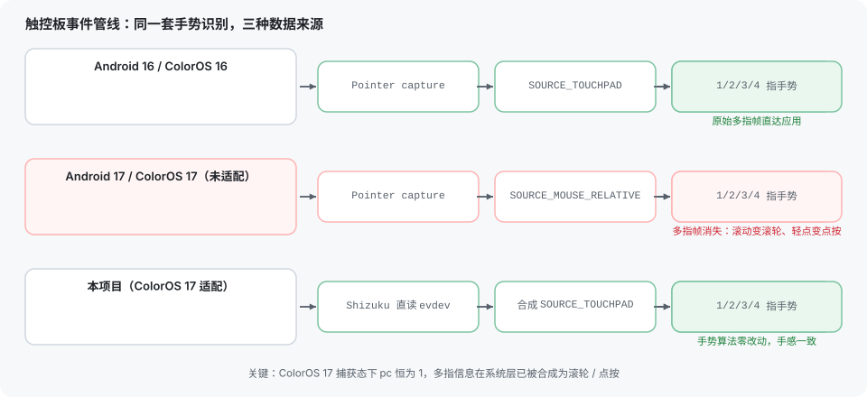
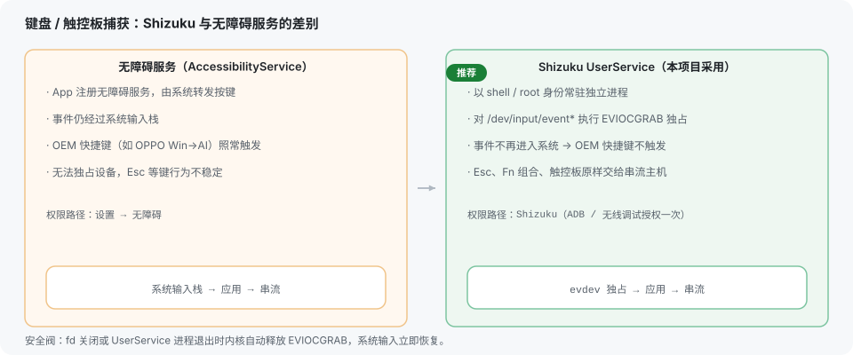
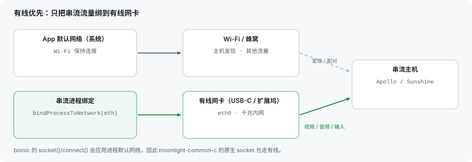

<p align="right"><a href="README.md">中文</a> | <b>English</b></p>

# Artemis Android · OPPO Touchpad Edition

A Moonlight fork for **Android tablets and 2-in-1 devices**, built on top of [Artemis Android](https://github.com/ClassicOldSong/moonlight-android). It adds deep support for the **official OPPO Pad magnetic-keyboard trackpad**, uses **[Shizuku](https://github.com/RikkaApps/Shizuku) instead of an accessibility service** for keyboard/mouse capture, and prefers **wired Ethernet** for streaming. The host side is [Apollo](https://github.com/ClassicOldSong/Apollo) / [Sunshine](https://github.com/LizardByte/Sunshine).

> The goal is simple: **make a tablet with a magnetic keyboard trackpad feel like a laptop with a trackpad** - one finger is a mouse, two fingers scroll, three or four fingers behave like a Windows precision touchpad.

---

## Highlights

### 1. Deep OPPO trackpad support (including ColorOS 17 / Android 17)

The whole "Mac-like trackpad feel" stack was rebuilt on the client: time-based pointer acceleration, sampling-rate independent velocity estimation, kinetic scrolling, pinch-vs-scroll disambiguation and three/four-finger state machines. Everything is synthesized client-side, so **the host needs no special support**.

Android 17 (ColorOS 17) changed touchpad delivery: pointer capture still works, but apps only receive **single-pointer** `SOURCE_MOUSE_RELATIVE` events - scrolling is pre-synthesized into wheel events, taps into button presses, and raw two/three/four-finger contacts are **no longer delivered at all**. That silently kills every multi-finger gesture. This fork reads the touchpad's **evdev node directly through Shizuku** (shell uid and `EVIOCGRAB`), then re-synthesizes `SOURCE_TOUCHPAD` frames for the very same gesture pipeline, so gesture logic and feel stay identical.



### 2. Shizuku instead of an accessibility service

Keyboard capture runs in a **Shizuku UserService** (a persistent process with shell/root uid) that grabs `/dev/input/event*` with `EVIOCGRAB`:

- Events **never enter the system input stack**, so OEM shortcuts such as OPPO's `Win → AI` no longer fire while streaming;
- Physical Esc, Fn combinations and function keys reach the host unchanged;
- Closing the fd or killing the UserService makes the kernel **release the grab automatically**, so system input always comes back (a crash cannot lock your keyboard).



### 3. Wired-first streaming

With a USB-C Ethernet adapter or dock, only the **stream traffic** is bound to the wired interface while the rest of the system keeps using Wi-Fi:

- Built on `ConnectivityManager.bindProcessToNetwork()`; bionic applies the process default network to every socket created afterwards, so `moonlight-common-c`'s native sockets go over Ethernet too;
- Concurrent sessions (e.g. an external-display session) share the binding through a reference count and unbind only when the last holder releases it.



### 4. Other fork enhancements

- **Contact filtering**: reading evdev bypasses the stock noise/palm filters, so a light filter drops sensor noise and a thumb resting on the pad instead of letting it turn a two-finger scroll into a three-finger swipe;
- **Click debouncing**: contact churn while scrolling and two-finger taps no longer produce stray left clicks;
- Selectable keyboard capture (Shizuku / accessibility service) with a live "active" status;
- Guided Shizuku authorization on first use, plus a toast at stream start when capture is not active;
- Everything else from upstream Artemis is preserved (virtual buttons, custom resolutions and bitrates, external monitor mode, performance overlay, clipboard sync, SBS 3D for external displays, ...).

---

## Trackpad gestures

Defaults follow Windows touchpad semantics; sensitivity and axes are configurable in settings.

| Gesture | Action |
|---|---|
| One-finger slide | Move the cursor (with pointer acceleration) |
| One-finger tap | Left click |
| Double-tap and hold, then drag | Drag / select |
| Two-finger slide (any direction) | Wheel scroll (kinetic, diagonal supported) |
| Two-finger tap | Right click |
| Two-finger pinch / spread | `Ctrl` + wheel (zoom) |
| Three-finger swipe left / right | `Alt+Tab` switcher (hold to keep stepping, lift to confirm) |
| Three-finger swipe up / down | `Win+Tab` task view / `Win+D` show desktop |
| Three-finger tap | `Alt+Tab` |
| Four-finger swipe left / right | Previous / next virtual desktop |
| Four-finger swipe up / down | Task view / show desktop (swipe down again to restore) |
| Four-finger tap | Notification center |
| Physical trackpad click | Left click |

Related settings: trackpad sensitivity X/Y, swap X/Y axes, drag activation delay and haptics, and **Read the touchpad directly** (enabled by default on Android 17 / ColorOS 17).

---

## Install

* [Download the APK](https://github.com/iluluyu/moonlight-android/releases)
* [Update with Obtainium (recommended)](https://apps.obtainium.imranr.dev/redirect?r=obtainium://app/%7B%22id%22%3A%22com.limelight.noir%22%2C%22url%22%3A%22https%3A%2F%2Fgithub.com%2Filuluyu%2Fmoonlight-android%22%2C%22author%22%3A%22iluluyu%22%2C%22name%22%3A%22Artemis%22%2C%22additionalSettings%22%3A%22%7B%5C%22apkFilterRegEx%5C%22%3A%5C%22nonRoot%5C%22%2C%5C%22matchGroutToUse%5C%22%3A%5C%22%241%5C%22%2C%5C%22versionExtractionRegEx%5C%22%3A%5C%22v(.%2B)%5C%22%7D%22%7D)

## First-time setup: Shizuku

Keyboard capture and direct trackpad reading both rely on Shizuku:

1. Install [Shizuku](https://github.com/RikkaApps/Shizuku) (Play Store or GitHub releases);
2. Start the Shizuku service via **wireless debugging** or ADB;
3. Artemis → Settings → Keyboard capture → choose **Shizuku**;
4. Grant the permission; the status should read "active". A toast also reports capture state at stream start.

> Without Shizuku you can fall back to the accessibility service: the keyboard still works, but **direct trackpad reading** and OEM shortcut blocking are unavailable.

## Building

```sh
git submodule update --init --recursive
# put sdk.dir and ndk.dir into app/local.properties
./gradlew assembleNonRoot_gameDebug   # everyday debug build
./gradlew assembleRelease             # release build
```

## Known limitations

- The Alt+Tab / task-view overlay is placed by Windows (always on the primary display with multiple monitors); the Moonlight input protocol cannot target a display and does not report host-side window state;
- Gesture thresholds were tuned on a real OPPO Pad 4 Pro; other touchpads may need sensitivity tweaks or an issue report;
- The streaming protocol has no Windows Precision Touchpad contact channel, so gestures are synthesized into keyboard/mouse events on the client.

Implementation notes and on-device investigation logs live in [`docs/trackpad-handoff-note.md`](docs/trackpad-handoff-note.md) and [`docs/trackpad-gestures-design.md`](docs/trackpad-gestures-design.md).

---

## Acknowledgements

None of this would exist without these projects:

- **[Moonlight Android](https://github.com/moonlight-stream/moonlight-android)** - the origin of Android game streaming: protocol, decoding and rendering. Thanks to [Cameron Gutman](https://github.com/cgutman), [Diego Waxemberg](https://github.com/dwaxemberg), [Aaron Neyer](https://github.com/Aaronneyer), [Andrew Hennessy](https://github.com/yetanothername) and the students at [Case Western](http://case.edu) / [MHacks](http://mhacks.org).
- **[Artemis Android (Moonlight Noir)](https://github.com/ClassicOldSong/moonlight-android)** - the direct upstream of this fork; virtual buttons, custom resolutions/bitrates, external monitor mode, performance overlay, clipboard sync and SBS 3D all come from here. Thanks to [ClassicOldSong](https://github.com/ClassicOldSong).
- **[Apollo](https://github.com/ClassicOldSong/Apollo)** / **[Sunshine](https://github.com/LizardByte/Sunshine)** - the host-side streaming servers and virtual-display integration.
- **[Shizuku](https://github.com/RikkaApps/Shizuku)** - provides a no-root shell-level channel; this fork builds exclusive device capture and evdev touchpad reading on top of it. Thanks to [Rikka](https://github.com/RikkaW).
- **[moonlight-common-c](https://github.com/moonlight-stream/moonlight-common-c)** - the streaming protocol core (submodule).
- And everyone who reported real-device behaviour in issues and PRs - most of the OPPO trackpad feel parameters were ground out from real logs.

Fork-specific changes are maintained by [iluluyu](https://github.com/iluluyu) under the same open-source license as the original projects.
